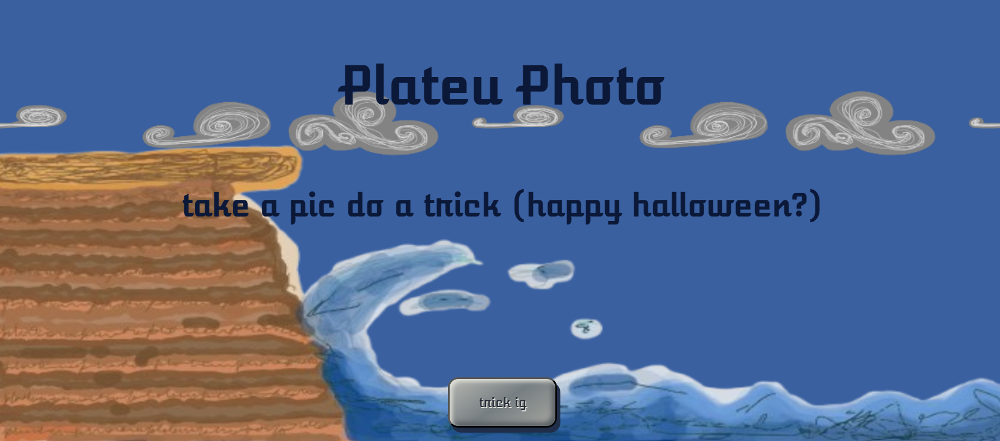
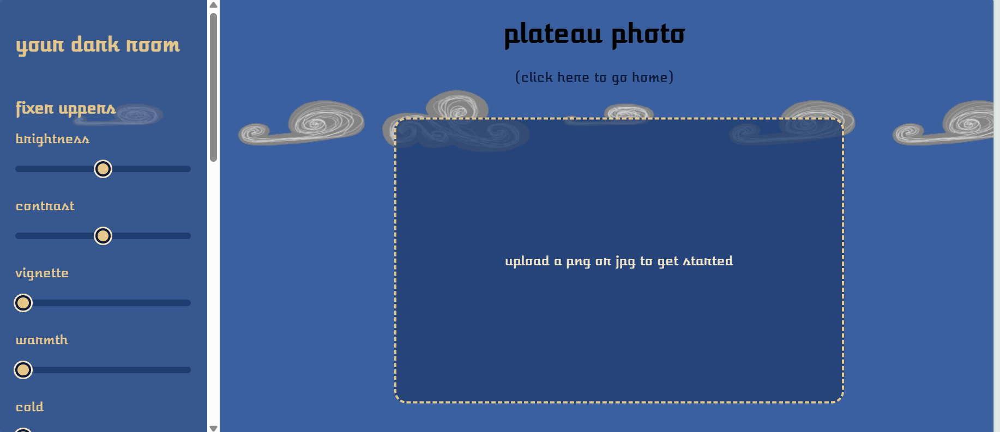

hi there , this is plateu photo (i googled what rhymed with photo and it said plateu and i was sleep deprived so it made sense(it doesnt rhyme))
okay anyways first off you will click on the link and be absolutely blessed with my art work of a plateu and a wave then if u need to scroll scroll and press the cobble stone button that im really proud of. also take min to admire my clouds. if you didnt its fine just wait till the next page.
okay so heres the home page.

pic rhymes with trick so yeah 
okayy once you click on it you see clouds, an av drag and drop place (honestly respect to ppl who do 5 extra lines for our laziness).

this page!!
okay so contrast and brightness start in the middle and yeah you have to have seen these controls before then theres a list of filters and actions like flip and roate.
once youre happy with your picture just click on see og to see what it looked like earlier vs now.
then simplyyy download it!!
and once youve downloaded the picture using the doenload button you can chilll and restart!!
and add another picture.
this works in cahoots with olivers camera, i mean a camera and a photo editor eho are we kidding , covered all bases. but yeahh hope you enjoy !